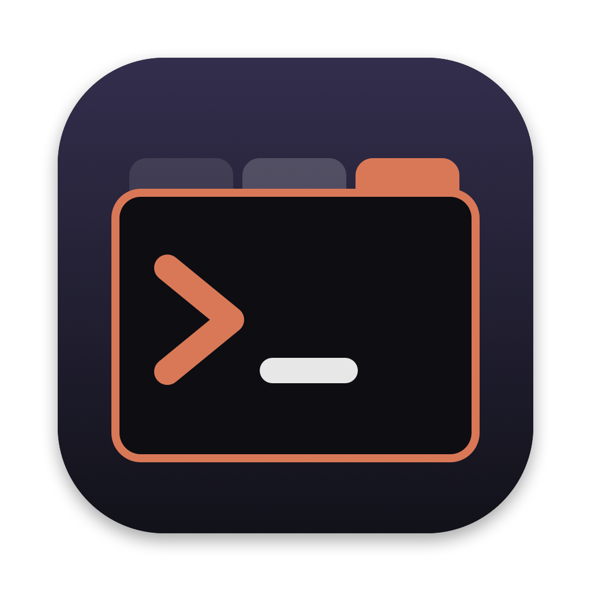

# AgentTabs

<<<<<<< HEAD


A tiny native macOS app for running coding agents side by side. Each top tab is one agent session (Claude Code, Codex, Gemini, opencode, aider, … or any command) in a folder; inside it, a terminal tab opens alongside the agent in that same folder (fish, which `build.sh` installs via Homebrew; falls back to your `$SHELL`).
=======
A tiny native macOS app for running coding agents side by side. Each top tab is one agent session (Claude Code, Codex, Gemini, opencode, aider, … or any command) in a folder; inside it, extra tabs are terminals in that same folder.
>>>>>>> f9b57f6411a8e3f688c29c118ef0f0d16a1918e1

## Install

Requires macOS 13+ and Xcode command line tools (`xcode-select --install`).

```sh
git clone <this repo> && cd agent-tabs
./build.sh   # builds and installs /Applications/AgentTabs.app
```

## Shortcuts

| Keys | Action |
|---|---|
| ⌘N | New agent session (pick folder + agent) |
| ⌃N | New terminal in the current session |
| ⌘1…9 | Switch session |
| ⌃1…9 | Switch tab inside the session |
| ⌥⌘[ / ⌥⌘] | Previous / next tab |
| ⌘W | Close tab (the last one closes the session) |
| ⇧⌘W | Close session |
| ⌘/ | Show shortcuts |

If ⌃1…9 does nothing, disable "Switch to Desktop N" in System Settings › Keyboard › Keyboard Shortcuts › Mission Control.

Built on [SwiftTerm](https://github.com/migueldeicaza/SwiftTerm). MIT licensed.
